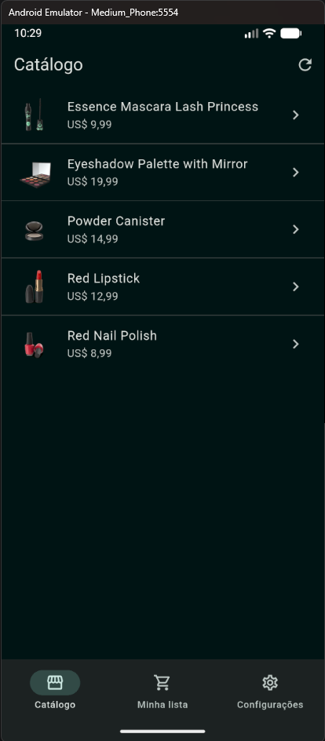
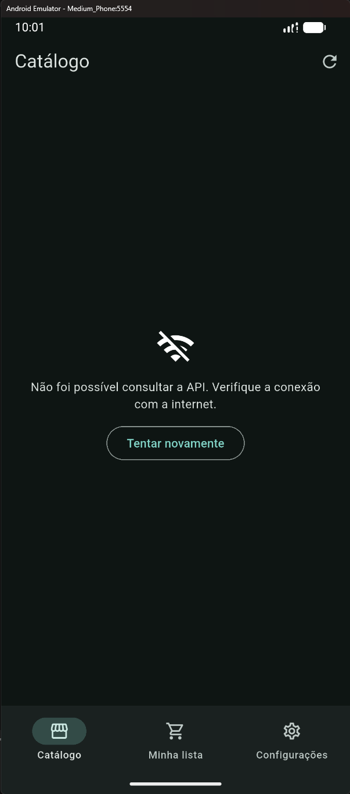

# P2 de Flutter — Minha Lista de Compras

- Aluno(a): Eduardo Cortez Da Silva
- RA: 202410152
- Aluno(a): Eduardo Henrique Taborda e Silva
- RA: 202410018
- Turma: Ciencia da Computação - 6º semestre.

## De onde vem cada dado

| Recurso           | O que guarda / fornece                                                                    |
|-------------------|-------------------------------------------------------------------------------------------|
| API REST          | Catálogo e dados dos detalhes: `id`, `title`, `price`, `description`, `thumbnail`         |
| SQLite            | Tabela `itens_compra` em `compras.db`: `produto_id`, `nome`, `preco_centavos`, `quantidade`, `comprado` |
| SharedPreferences | `tema_escuro` (bool, padrão false) e `somente_pendentes` (bool, padrão false)             |

O preço é gravado em centavos, com `(preco * 100).round()`, para que subtotal e total sejam contas com inteiros. O `produto_id` é a chave primária, então o banco não aceita o mesmo produto duas vezes.

## Como executar no Android (VS Code)

1. Abra a pasta `minha_lista_de_compras` no VS Code.
2. No terminal do VS Code, execute uma vez:

```
flutter create --platforms android .
flutter pub get
flutter analyze
```

3. Abra o emulador Android: `Ctrl+Shift+P` → **Flutter: Launch Emulator**, ou pelo canto inferior direito da barra de status. Não selecione Windows nem Chrome: o SQLite deste projeto funciona no Android.
4. Confira com `flutter devices` e execute com `flutter run -d ID_DO_EMULADOR`, ou abra `lib/main.dart` e pressione **F5**.

A permissão de internet já está no `android/app/src/main/AndroidManifest.xml`:

```xml
<uses-permission android:name="android.permission.INTERNET" />
```

**Captura 1: catálogo com cinco produtos**



**Captura 2: mensagem de erro sem conexão**



## Dados de teste

| Item | Produto do catálogo (id)           | Preço anotado | Quantidade usada | Observação                       |
|------|------------------------------------|--------------:|-----------------:|----------------------------------|
| 1    | Essence Mascara Lash Princess (1)  | US$ 9,99      | 3                | Adicionar duas vezes; marcar comprado |
| 2    | Eyeshadow Palette with Mirror (2)  | US$ 19,99     | 1                | Excluir no T7                    |

Conferir os preços no catálogo antes de adicionar. Se forem diferentes, refazer as contas abaixo.

Fórmulas usadas: subtotal 1 = 3 × 9,99 = 29,97; subtotal 2 = 1 × 19,99 = 19,99; total = 29,97 + 19,99 = 49,96.

## Resultados esperados

| Momento                                        | Itens no banco | Itens visíveis | Total estimado |
|------------------------------------------------|---------------:|---------------:|---------------:|
| Após adicionar o item 1 duas vezes (T3)        | 1              | 1              | US$ 9,99       |
| Após adicionar o item 2 e mudar o 1 para 3 (T4)| 2              | 2              | US$ 49,96      |
| Após tentar gravar 0 e 100 (sem mudança)       | 2              | 2              | US$ 49,96      |
| Item 1 comprado + filtro ligado (T5)           | 2              | 1              | US$ 49,96      |
| Após reabrir o app (T6)                        | 2              | 1              | US$ 49,96      |
| Após cancelar a exclusão do item 2 (T7)        | 2              | conforme filtro | US$ 49,96     |
| Após confirmar a exclusão do item 2 (T7)       | 1              | conforme filtro | US$ 29,97     |

## Testes de aceitação (T1 a T7)

Aparelho / emulador: medium phone

| Teste | O que foi feito                                                        | Resultado observado              | Status   |
|-------|------------------------------------------------------------------------:|----------------------------------:|---------------:|
| T1    | Abrir o catálogo com internet e selecionar um produto                  | Teste saiu como esperado         |   OK     |
| T2    | Sem rede, tocar em Atualizar; religar e tocar em Tentar novamente      | Teste saiu como esperado         |   OK     |
| T3    | Adicionar o mesmo produto duas vezes e abrir Minha lista               | Teste saiu como esperado         |   OK     |
| T4    | Adicionar outro produto; mudar o primeiro para 3; tentar 0 e 100       | Teste saiu como esperado         |   OK     |
| T5    | Marcar o primeiro como comprado e ligar o filtro de pendentes          | Teste saiu como esperado         |   OK     |
| T6    | Ligar tema escuro e filtro; fechar e reabrir o app                     | Teste saiu como esperado         |   OK     |
| T7    | Sem rede: editar um item, cancelar uma exclusão e depois confirmar     | Teste saiu como esperado         |   OK     |